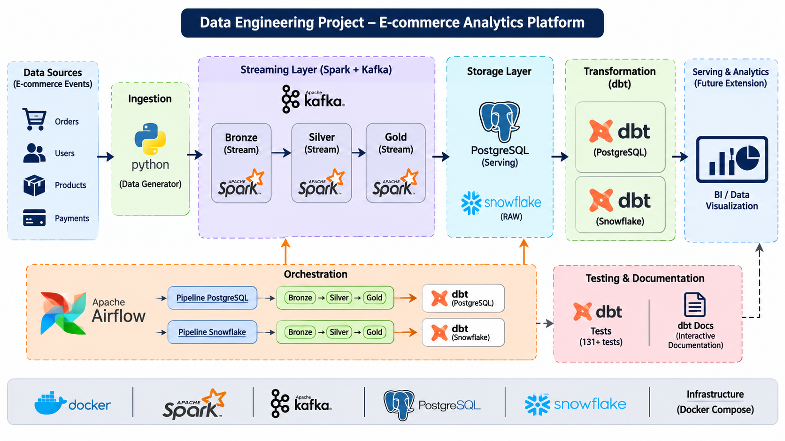
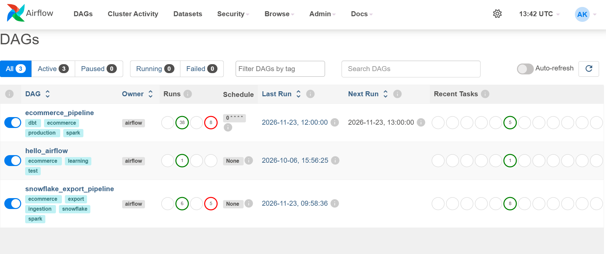
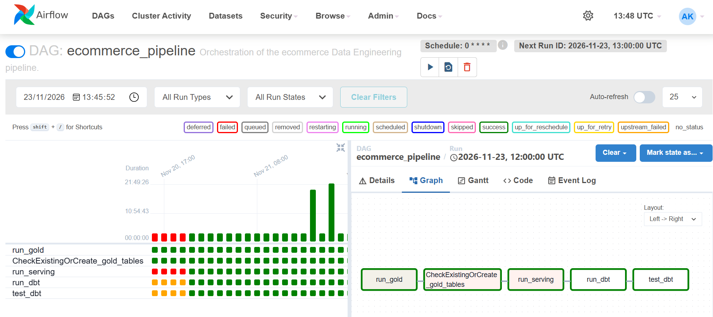
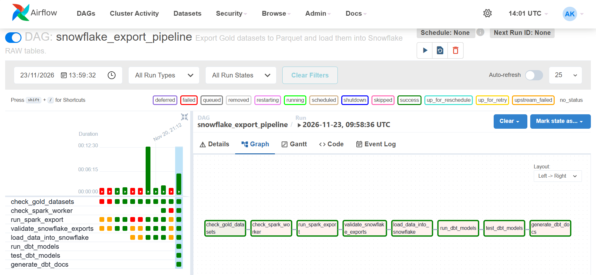
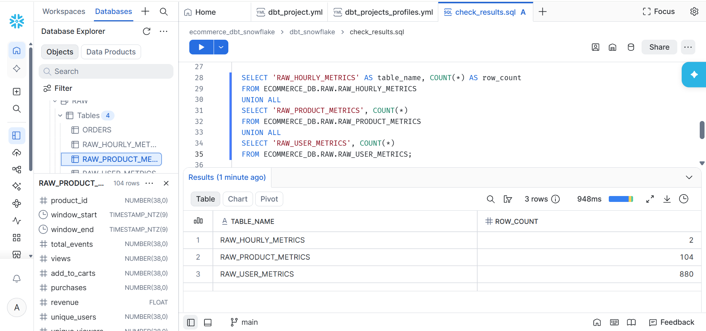
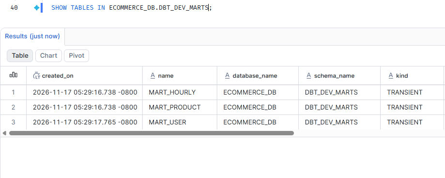
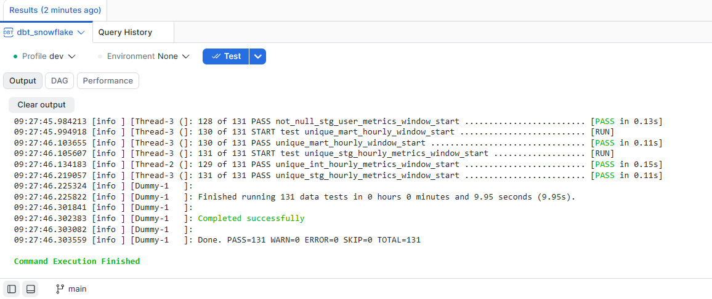
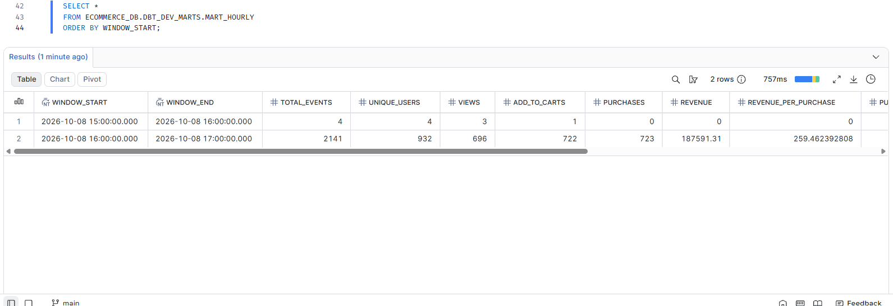
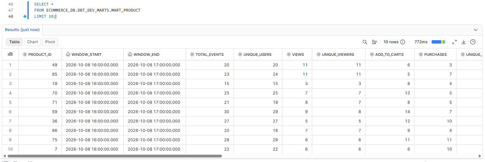
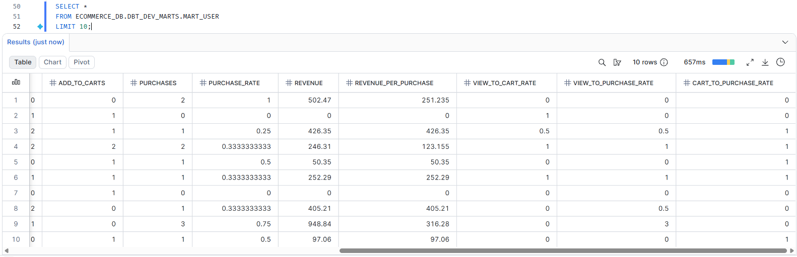

# Real-Time E-commerce Data Platform

An end-to-end Data Engineering platform that simulates e-commerce events, processes streaming data with Apache Spark, builds analytical datasets, and orchestrates data transformations across PostgreSQL and Snowflake.

The platform combines real-time data processing, batch workflows, data quality validation, and analytical modeling using modern Data Engineering technologies.

Built with Docker Compose, the project provides a reproducible local environment to demonstrate the design and implementation of an end-to-end data platform.

## Overview

This project implements an end-to-end e-commerce data platform, from event generation to analytics-ready datasets.

The main objectives are to:

- Generate and ingest simulated e-commerce events using Python and Apache Kafka.
- Process streaming data using Spark Structured Streaming.
- Organize processed data into Bronze, Silver, and Gold layers.
- Store analytical metrics in PostgreSQL.
- Export Gold datasets as Parquet files.
- Load analytical datasets into Snowflake.
- Build analytical models using dbt.
- Validate transformations with automated data quality tests.
- Orchestrate data workflows using Apache Airflow.
- Generate dbt documentation automatically.

The project demonstrates two complementary analytical pipelines:

1. A PostgreSQL-based pipeline for serving analytical metrics.
2. A Snowflake-based pipeline for cloud data warehousing and analytical modeling.

The goal is to build a reproducible data platform using technologies commonly found in modern data engineering environments.

## Architecture

The platform follows a layered data architecture.

<p align="center">
  
</p>

<p align="center">
  <em>High-level architecture</em>
</p>


### Data Lake Architecture

The data lake is organized into three layers:

| Layer | Responsibility |
|---|---|
| Bronze | Stores initially ingested streaming events. |
| Silver | Contains cleaned and transformed records. |
| Gold | Contains analytical datasets prepared for downstream consumption. |

## Technology Stack

| Technology              | Purpose                                                             |
|-------------------------|---------------------------------------------------------------------|
| Python                  | Event generation, ingestion, data processing and automation scripts |
| Apache Kafka            | Event streaming and message transport                               |
| Apache Spark 3.5.1      | Distributed processing and Structured Streaming                     |
| Data Lake               | Storage of Bronze, Silver and Gold datasets                         |
| PostgreSQL 15           | Storage of serving-ready analytical metrics                         |
| Snowflake               | Cloud data warehouse and analytical storage                         |
| dbt Core                | SQL transformations, data modeling and quality tests                |
| Apache Airflow 2.10.5   | Workflow orchestration                                              |
| Docker & Docker Compose | Containerization and local infrastructure                           |
| pgAdmin                 | PostgreSQL database administration                                  |
| Git                     | Version control                                                     |


## Data Pipeline

### 1. Event Ingestion

A Python producer generates simulated e-commerce events and publishes them to the Kafka topic `ecommerce_events`.

Kafka decouples event generation from downstream processing and provides the streaming infrastructure used by Spark.

### 2. Streaming Processing

Spark Structured Streaming consumes events from Kafka and processes them through three data layers.

**Bronze**

- Receives the initial streaming events.
- Preserves the ingested data for downstream processing.

**Silver**

- Cleans and transforms incoming records.
- Prepares structured data for analytical processing.

**Gold**

- Computes analytical metrics.
- Produces datasets for downstream consumption.

The Gold layer contains three main datasets:

```text
lake/gold/
├── hourly_metrics/
├── product_metrics/
└── user_metrics/
```

The datasets are stored in Parquet format.

### 3. Gold Metrics and PostgreSQL

The Gold datasets are published to three PostgreSQL serving tables:

- `gold_hourly_metrics`
- `gold_product_metrics`
- `gold_user_metrics`

The serving scripts use PostgreSQL upserts to insert new metrics and update existing records when their keys match.

This provides a relational serving layer for analytical queries and downstream dbt transformations.

### 4. Snowflake Integration

The project also includes a separate pipeline that exports Gold datasets to Snowflake.

The integration follows these steps:

1. Validate the availability of the Gold datasets.
2. Check Spark Worker availability before starting the export.
3. Export the three Gold datasets as Parquet files.
4. Validate the generated export files.
5. Upload the files to a Snowflake internal stage.
6. Load the datasets into temporary Snowflake tables.
7. Validate the loaded records.
8. Refresh the permanent RAW tables transactionally.

The Snowflake RAW layer contains:

```text
ECOMMERCE_DB
└── RAW
    ├── RAW_HOURLY_METRICS
    ├── RAW_PRODUCT_METRICS
    └── RAW_USER_METRICS
```

The loading process uses temporary tables before refreshing the permanent RAW tables.

This approach allows the pipeline to validate incoming data before replacing the existing RAW contents.

The refresh operation uses a transaction so that the three datasets are updated together.

### 5. Analytics with dbt

The project contains two separate dbt projects.

**PostgreSQL dbt project**

The first dbt project builds analytical models from PostgreSQL serving tables.

It includes staging, intermediate and mart transformations, together with automated data quality tests.

The latest recorded successful validation completed with **54 dbt tests passing**. 

**Snowflake dbt project**

The second dbt project builds analytical models from the Snowflake RAW layer.

It follows a layered modeling approach:

```text
Snowflake RAW -> Staging -> Intermediate -> Marts
```

The project contains 9 dbt models.

The latest successful validation completed with 131 passing tests.

`The two dbt projects are independent and use separate configurations and database connections.`

### 6. Airflow Orchestration

Apache Airflow orchestrates the batch and analytical workflows.

The project contains two main DAGs.



#### PostgreSQL Pipeline

DAG:

`ecommerce_pipeline`

This DAG orchestrates the publication of Gold metrics to PostgreSQL and their analytical transformations.

It contains five sequential tasks:

| Order | Task                     | Responsibility                                      |
|-------|--------------------------|-----------------------------------------------------|
| 1     | `run_gold`               | Checks the availability of the three Gold datasets. |
| 2     | `check_or_create_tables` | Creates the PostgreSQL serving tables if necessary. |
| 3     | `run_serving`            | Publishes Gold metrics to PostgreSQL.               |
| 4     | `run_dbt`                | Builds the PostgreSQL dbt models.                   |
| 5     | `test_dbt`               | Executes the PostgreSQL dbt tests.                  |

The DAG is configured to run hourly:

```python
schedule="0 * * * *"
```

It also uses:

```python
catchup=False
max_active_runs=1
```

These settings prevent the creation of historical scheduled runs and avoid overlapping active DAG runs.



#### Snowflake Pipeline

DAG:

`snowflake_export_pipeline`

This DAG orchestrates the export of Gold datasets, their loading into Snowflake, and the dbt transformations.

It contains eight sequential tasks:

| Order | Task | Responsibility |
|---|---|---|
| 1 | `check_gold_datasets` | Validates the availability of the Gold datasets. |
| 2 | `check_spark_worker` | Checks Spark Worker availability and minimum resource requirements. |
| 3 | `run_spark_export` | Exports Gold datasets as Parquet files. |
| 4 | `validate_snowflake_exports` | Validates the generated Parquet files. |
| 5 | `load_data_into_snowflake` | Loads the datasets into Snowflake RAW tables. |
| 6 | `run_dbt_models` | Builds the Snowflake dbt models. |
| 7 | `test_dbt_models` | Executes Snowflake dbt data quality tests. |
| 8 | `generate_dbt_docs` | Generates the dbt documentation artifacts. |

The Snowflake DAG currently uses manual triggering during development:

```python
schedule=None
```



**Important:** Both DAGs use Airflow to coordinate batch and analytical operations, while Kafka ingestion and Spark streaming applications operate independently.

## Data Quality

Data quality is validated at multiple stages of the platform.

**Pipeline-level validation**

- Checks that Gold datasets exist.
- Checks that Spark Worker resources meet minimum requirements.
- Validates the generated Parquet files.
- Checks that exported files are non-empty.
- Validates the number of records loaded into temporary Snowflake tables.
- Verifies the permanent RAW table record counts before committing the refresh transaction.

**dbt validation**

The project currently has two separate dbt test suites.

| dbt Project | Database | Passing Tests |
|---|---|---:|
| PostgreSQL | PostgreSQL | 54 |
| Snowflake | Snowflake | 131 |
| **Total** | | **185** |

Latest recorded successful Snowflake dbt execution:

```text
PASS=131 WARN=0 ERROR=0 SKIP=0 TOTAL=131
```

These results represent successful executions during project validation. They do not guarantee that future datasets will always pass the same tests.

## dbt Documentation

The Snowflake dbt project generates documentation automatically as the final task of its Airflow DAG.

The command executed is:

```bash
dbt docs generate --target dev
```

The generated documentation includes:

| File | Purpose |
|---|---|
| `index.html` | Interactive dbt documentation interface |
| `manifest.json` | Project metadata, models and dependencies |
| `catalog.json` | Database metadata and column information |
| `run_results.json` | Results of the latest dbt execution |

The generated files are stored in:

```text
dbt_snowflake/target/
```

The documentation can be served using:

```bash
docker compose exec dbt-snowflake dbt docs serve --host 0.0.0.0
```

For browser access from the host machine, the container service must also expose and map the documentation server port.

## Prerequisites

Before starting, install:

- [Docker Desktop](https://www.docker.com/products/docker-desktop/)
- Docker Compose, included with current Docker Desktop installations.
- Git, if you want to clone the repository.

For the complete Snowflake pipeline, you also need:

- A Snowflake account.
- A configured Snowflake warehouse, database, schemas and role.
- A Snowflake service user.
- RSA key-pair authentication for the service user.

The project is designed to run locally using Docker Compose.

Make sure Docker has sufficient CPU and memory resources to run the services you intend to start.

## Getting Started
The project uses Docker Compose to manage its services.
Build the required images and start the infrastructure.

### 1. Clone the repository

```bash
git clone https://github.com/absonkab/data-engineering-ecommerce.git
cd data-engineering-ecommerce
```

### 2. Configure environment variables

Create a local `.env` file from the example:

**Windows PowerShell**

```powershell
Copy-Item .env.example .env
```

**Linux / macOS**

```bash
cp .env.example .env
```

Review `.env` and configure the required values, including:

- PostgreSQL credentials and database name.
- Airflow credentials.
- Service ports.
- Spark resource settings.
- Snowflake account and service-user configuration.

Keep `.env` local. Never commit passwords, private keys or other sensitive credentials to Git.

#### Spark Resource Allocation

The project runs five Spark Structured Streaming applications concurrently:

* Bronze Streaming
* Silver Streaming
* Gold Hourly Metrics
* Gold Product Metrics
* Gold User Metrics

The default local configuration allocates:

- **5 CPU cores** to the Spark worker
- **6 GB RAM** to the Spark worker
- **1 CPU core maximum** per streaming application

These settings help distribute resources across the streaming applications in a local development environment.

Adjust the values in `.env` if your machine has different resource limits.

### 3. Configure Snowflake authentication

The Snowflake pipeline uses RSA key-pair authentication.

The private key must be stored locally in the project's secrets directory and mounted read-only into the relevant container.

Example directory:

```text
secrets/
└── snowflake/
    ├── rsa_key.p8
    └── rsa_key.pub
```

Configure the public key on the Snowflake service user.

The private key must never be committed to GitHub or shared publicly.

Configure the Snowflake connection variables in `.env` according to the project's environment configuration.

### 4. Validate the Docker Compose configuration

```bash
docker compose config --quiet
```

If the command completes without an error, the Compose configuration is valid.

### 5. Build and start the services

Build and start the infrastructure:

```bash
docker compose up -d --build
```

For local development, you can also start individual services when needed:

```bash
docker compose up -d service_name
```

Refer to the Docker Compose configuration for the exact service names and dependencies.

The `kafka-init` service waits for Kafka to become available and creates the `ecommerce_events` topic if it does not already exist.

The folder `sql/serving` and PostgreSQL initialization scripts are mounted into:

```text
/docker-entrypoint-initdb.d/
```

These scripts are executed automatically when PostgreSQL initializes a new, empty data directory.

For an existing database, the Airflow PostgreSQL DAG also includes a task `create_gold_tables` to create the serving tables (from `create_gold_tables.sql`) if necessary.


### 6. Check the running containers

Verify the status of the services:

```bash
docker compose ps
```

Inspect container logs:

```bash
docker compose logs --tail=100
```

Inspect Kafka initialization and ingestion:

```bash
docker compose logs --tail=50 kafka-init ingestion
```

List Kafka topics:

```bash
docker exec kafka kafka-topics --bootstrap-server kafka:9092 --list
```

The `ecommerce_events` topic should be present.

Confirm that the ingestion service produces events and that the Spark Structured Streaming applications process them.

Check that the Bronze, Silver and Gold datasets are being generated.

## Running the Pipelines

### PostgreSQL Pipeline

Once the required services are running and the `ecommerce_pipeline` DAG is enabled, Airflow schedules it hourly.

To trigger it manually:

1. Open the Airflow interface.
2. Navigate to `ecommerce_pipeline`.
3. Ensure the DAG is not paused.
4. Trigger a new DAG run.
5. Open the Graph view.
6. Verify that all five tasks complete successfully.

### Snowflake Pipeline

The Snowflake pipeline is currently triggered manually.

Before triggering it, make sure the following services are available:

- Airflow Scheduler.
- Spark Master.
- Spark Worker.
- Spark Job container.
- dbt-Snowflake container.

Then:

1. Open the Airflow interface.
2. Navigate to `snowflake_export_pipeline`.
3. Trigger a new DAG run.
4. Open the Graph view.
5. Follow the eight tasks.
6. Verify that all tasks complete successfully.

The pipeline will export the Gold datasets, load them into Snowflake, execute dbt transformations and tests, and generate the documentation.

## Accessing the Interfaces

When the corresponding services are running, access the interfaces using the configured local ports.

| Service           | Local address         |
| ----------------- | --------------------- |
| Spark Master UI   | http://localhost:8080 |
| pgAdmin           | http://localhost:5050 |
| Postgres dbt doc  | http://localhost:8081 |
| Airflow           | http://localhost:8082 |


Snowflake is accessed through its web interface.

The Snowflake dbt documentation is generated locally in `dbt_snowflake/target/`. To access it through a browser, start the dbt documentation server and configure the corresponding Docker port mapping.

Use the credentials configured in `.env` where authentication is required.

## Data Validation

### Verify PostgreSQL serving tables

List the three Gold serving tables:

```bash
docker exec postgres psql -U data_user -d ecommerce -c "\dt gold_*"
```

Replace the username and database name if your `.env` uses different values.

Expected tables:

```text
gold_hourly_metrics
gold_product_metrics
gold_user_metrics
```

### Verify Gold datasets

The Gold datasets should contain Parquet files under:

```text
lake/gold/hourly_metrics/
lake/gold/product_metrics/
lake/gold/user_metrics/
```

### Verify Snowflake RAW tables

Connect to Snowflake and execute:

```sql
SELECT COUNT(*) FROM ECOMMERCE_DB.RAW.RAW_HOURLY_METRICS;

SELECT COUNT(*) FROM ECOMMERCE_DB.RAW.RAW_PRODUCT_METRICS;

SELECT COUNT(*) FROM ECOMMERCE_DB.RAW.RAW_USER_METRICS;
```



### Verify dbt models

For the Snowflake dbt project:

```bash
docker compose exec dbt-snowflake dbt ls --resource-type model
```

Run the models manually if needed:

```bash
docker compose exec dbt-snowflake dbt run --target dev
```

Execute the tests:

```bash
docker compose exec dbt-snowflake dbt test --target dev
```

Generate documentation:

```bash
docker compose exec dbt-snowflake dbt docs generate --target dev
```
<p align="center">
  
  
</p>

| Mart hourly | Mart Product | Mart User |
|----------|----------|----------|
|  |  |  |

## Configuration and Data Persistence

The project uses Docker Compose volumes to share data and configuration between services.

The Gold data lake is mounted into the relevant containers at:

```text
/lake
```

Airflow uses the same mount to validate the Gold datasets and orchestrate downstream operations.

PostgreSQL data is persisted in a Docker volume.

Snowflake credentials are mounted read-only into the relevant containers.

**Do not use `docker compose down -v` unless you intentionally want to remove the Compose-managed volumes.**

Removing database volumes can delete persisted data.

For a normal shutdown:

```bash
docker compose down
```

To restart services:

```bash
docker compose up -d
```

## Troubleshooting

### Kafka topic is missing

Check that Kafka is running:

```bash
docker compose ps kafka
```

Inspect initialization logs:

```bash
docker compose logs kafka-init
```

List the topics:

```bash
docker exec kafka kafka-topics --bootstrap-server kafka:9092 --list
```

### Gold datasets are missing

Check the Spark streaming services:

```bash
docker compose ps
```

Inspect the logs:

```bash
docker compose logs --tail=100 bronze-stream silver-stream gold-hourly gold-product gold-user
```

### PostgreSQL serving tables are missing

Check PostgreSQL:

```bash
docker compose ps postgres
```

Inspect its logs:

```bash
docker compose logs --tail=100 postgres
```

Verify the SQL initialization files:

```bash
docker exec postgres ls -l /docker-entrypoint-initdb.d/
```

You can also trigger the PostgreSQL Airflow DAG to execute the table creation task.

### Airflow tasks fail

Inspect the scheduler logs:

```bash
docker compose logs --tail=100 airflow-scheduler
```

Open the failed task in the Airflow interface and review its logs to identify the underlying error.

### Spark Worker is unavailable

Check the Spark Worker:

```bash
docker compose ps spark-worker
```

Start it if necessary:

```bash
docker compose start spark-worker
```

The Snowflake DAG checks Worker availability and minimum free resources before executing the Spark export.

### Snowflake loading fails

Check that the Snowflake container is running:

```bash
docker compose ps dbt-snowflake
```

Inspect its logs:

```bash
docker compose logs --tail=100 dbt-snowflake
```

Verify the Snowflake connection configuration, RSA key permissions and role privileges.

### dbt tests fail

Inspect the `run_dbt_models` and `test_dbt_models` task logs in Airflow.

Verify the relevant dbt profile, database connection and source tables.

For Snowflake, check that the RAW tables contain the expected records.

## Project progress

- [x] Setup infrastructure (Docker, Kafka, Spark, Postgres)
- [x] Kafka Ingestion 
    <details>
    <summary>Click to see details</summary>

    - Kafka topic creation: 
    ```docker exec kafka kafka-topics --create --topic ecommerce_events --bootstrap-server localhost:9092 --partitions 1 --replication-factor 1 ```
    - List topics: ```docker exec kafka kafka-topics --list --bootstrap-server localhost:9092```
    - Run main.py (Start docker ingestion container)
    - Check a topic content: ```docker exec kafka kafka-console-consumer --bootstrap-server localhost:9092 --topic ecommerce_events --from-beginning```
- [x] Spark Streaming
    <details>
    <summary>Click to see details</summary>

    - [x] parsing JSON + typage + Kafka metadata
    - [x] Bronze Layer
        <details>
        <summary>Click to see details</summary>

        - Run bronze stream spark-submit: ```docker exec spark-job /opt/spark/bin/spark-submit --master spark://spark:7077 --packages org.apache.spark:spark-sql-kafka-0-10_2.12:3.5.1 /opt/spark/jobs/bronze_stream.py```
    - [x] Silver Layer
        <details>
        <summary>Click to see details</summary>
        
        - Run silver stream spark-submit: ```docker exec spark-job /opt/spark/bin/spark-submit --master spark://spark:7077 --packages org.apache.spark:spark-sql-kafka-0-10_2.12:3.5.1 /opt/spark/jobs/silver_stream.py```
    - [x] Gold Layer
        <details>
        <summary>Click to see details</summary>

        - Run hourly metrics stream spark-submit: ```docker exec spark-job /opt/spark/bin/spark-submit --master spark://spark:7077 --packages org.apache.spark:spark-sql-kafka-0-10_2.12:3.5.1 /opt/spark/jobs/hourly_metrics.py```
        - Run product metrics stream spark-submit: ```docker exec spark-job /opt/spark/bin/spark-submit --master spark://spark:7077 --packages org.apache.spark:spark-sql-kafka-0-10_2.12:3.5.1 /opt/spark/jobs/product_metrics.py```
        - Run user metrics stream spark-submit: ```docker exec spark-job /opt/spark/bin/spark-submit --master spark://spark:7077 --packages org.apache.spark:spark-sql-kafka-0-10_2.12:3.5.1 /opt/spark/jobs/user_metrics.py```
    - [x] Pipeline transformation tests
        <details>
        <summary>Click to see details</summary>

        - test silver_stream : ```docker exec -it spark-job pytest -v /opt/spark/tests/unit/test_silver.py```
        - test bronze_stream : ```docker exec -it spark-job pytest -v /opt/spark/tests/unit/test_bronze.py```
        - test hourly_metrics: ```docker exec -it spark-job pytest -v /opt/spark/tests/unit/test_hourly_metrics.py```
        - test product_metrics: ```docker exec -it spark-job pytest -v /opt/spark/tests/unit/test_product_metrics.py```
        - test user_metrics   : ```docker exec -it spark-job pytest -v /opt/spark/tests/unit/test_user_metrics.py```
        - test all from /tests/unit : ```docker exec -it spark-job pytest -v /opt/spark/tests/unit```
    - [x] Serving Layer
        <details>
        <summary>Click to see details</summary>

        - [x] create sql gold tables : -> bash: ```docker exec -i postgres psql -U data_user -d ecommerce < sql/serving/create_gold_tables.sql```
                                   -> PowerShell: ```Get-Content sql/serving/create_gold_tables.sql | docker exec -i postgres psql -U data_user -d ecommerce```
        - [x] publish hourly metrics into PostgreSQL. Run with ```docker exec -it spark-job python3 /opt/spark/jobs/serving/publish_hourly_metrics.py```
        - [x] publish product metrics into PostgreSQL. Run with ```docker exec -it spark-job python3 /opt/spark/jobs/serving/publish_product_metrics.py```
        - [x] publish user metrics into PostgreSQL. Run with ```docker exec -it spark-job python3 /opt/spark/jobs/serving/publish_user_metrics.py```
    - [x] Serving Layer Tests
        <details>
        <summary>Click to see details</summary>

        - [x] integration test JDBC connection : PowerShell: ```docker exec -it spark-job python3 /opt/spark/tests/integration/test_jdbc_connection.py```
        - [x] integration test jdbc upsert : ```docker exec -it spark-job python3 /opt/spark/tests/integration/test_jdbc_upsert.py```
        - [x] unit test postgres : ```docker exec -it spark-job pytest -v /opt/spark/tests/unit/test_postgres.py``` 
        - [x] unit test hourly_metrics_serving : ```docker exec -it spark-job pytest -v /opt/spark/tests/unit/test_hourly_metrics_serving.py```
        - [x] unit test product_metrics_serving : ```docker exec -it spark-job pytest -v /opt/spark/tests/unit/test_product_metrics_serving.py```
        - [x] unit test user_metrics_serving : ```docker exec -it spark-job pytest -v /opt/spark/tests/unit/test_user_metrics_serving.py```
    - [x] Create Streaming containers
        <details>
        <summary>Click to see details</summary>

        - [x] Bronze stream
        - [x] Silver stream
        - [x] Gold stream (hourly & product & user)
- [x] Data modeling (dbt)
    <details>
    <summary>Click to see details</summary>

    - [x] dbt installation (docker container)
        - Check dbt version : ```docker exec -it dbt dbt --version```
    - [x] Define dbt project, profile & adapter (PostgreSQL)
        - Diagnoctic dbt configuration : ```docker exec -it dbt dbt debug```
    - [x] Define dbt sources
        - Check if dbt soucres are detected: ```docker exec -it dbt dbt ls```
    - Run models in folder/package : ```docker exec -it dbt dbt run --select folder_name```
    - Run model with its dependances : ```docker exec -it dbt dbt run --select "+model_name"```
    - Run dbt parsing : ```docker exec -it dbt dbt parse```
    - [x] Staging models
        <details>
        <summary>Click to see details</summary>

        - [x] Hourly model
        - [x] Product model
        - [x] user model
    - [x] Intermediate models
        <details>
        <summary>Click to see details</summary>

        - [x] Product model
        - [x] User model
        - [x] Hourly model
    - [x] Mart models
        <details>
        <summary>Click to see details</summary>

        - [x] Product model
        - [x] User model
        - [x] Hourly model
    - [x] tests
        <details>
        <summary>Click to see details</summary>

        - [x] Product model
        - [x] User model
        - [x] Hourly model
        - Run dbt tests : ```docker exec -it dbt dbt test --select model_name```
    - [x] Generate dbt documentation
        <details>
        <summary>Click to see details</summary>

        - [x] Product model
        - [X] User model
        - [x] Hourly model
        - Generate dbt documentation : ```docker exec -it dbt dbt docs generate```
        - Run dbt docs server : ```docker exec -it dbt dbt docs serve --host 0.0.0.0 --port 8080```
- [X] Orchestration (Airflow)
    <details>
    <summary>Click to see details</summary>

    - [x] Airflow installation (init, webserver & scheduler)
    - [x] DAG 0 : First Test as Validation DAG
    - [x] DAG 1 : ecommerce pipeline (Gold metrics -> PostgreSQL Serving -> dbt transformations)
        <details>
        <summary>Click to see details</summary>

        - [x] Gold files check task
        - [x] Postgres serving task : publish data into PostgreSQL
        - [x] dbt task (Run dbt transformations)
    - [x] DAG 2 : Snowflake ecommerce pipeline (Gold metrics -> Consolidate Parquets files -> export & load into snowflake -> dbt transformations & docs)
        <details>
        <summary>Click to see details</summary>

        - [x] Consolidated Gold files check task
        - [x] Snowflake export task : Load gold data into snowflake RAW stage
        - [x] dbt task (Run dbt transformations)
- [ ] BI dashboard
- [ ] Final documentation and repository cleanup

## Future Improvements

Potential extensions include:

- Improve Spark resource allocation and capacity management.
- Implement stronger data freshness checks.
- Improve handling of late-arriving events.
- Extend data quality validation.
- Add monitoring and alerting for streaming applications.
- Improve pipeline observability and failure notifications.
- Implement CI/CD automation for code quality and pipeline validation.
- Add BI dashboards on top of analytical marts.
- Explore cloud deployment and additional data warehouse integrations.

## Author

**Yacouba Abass KABORE**

Data Engineer focused on data pipelines, streaming architectures, analytics and observability.

GitHub: 
* [@absonkab](https://github.com/absonkab) `https://github.com/absonkab`

---

This project is built for learning and portfolio purposes. 
It demonstrates the integration of streaming ingestion, distributed processing, data lake architecture, analytical modeling, cloud data warehousing, workflow orchestration and automated data quality validation.
